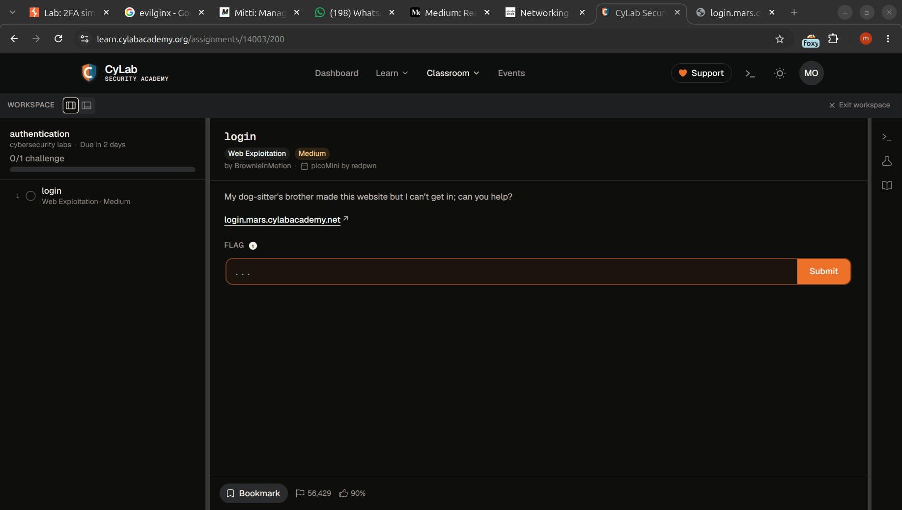
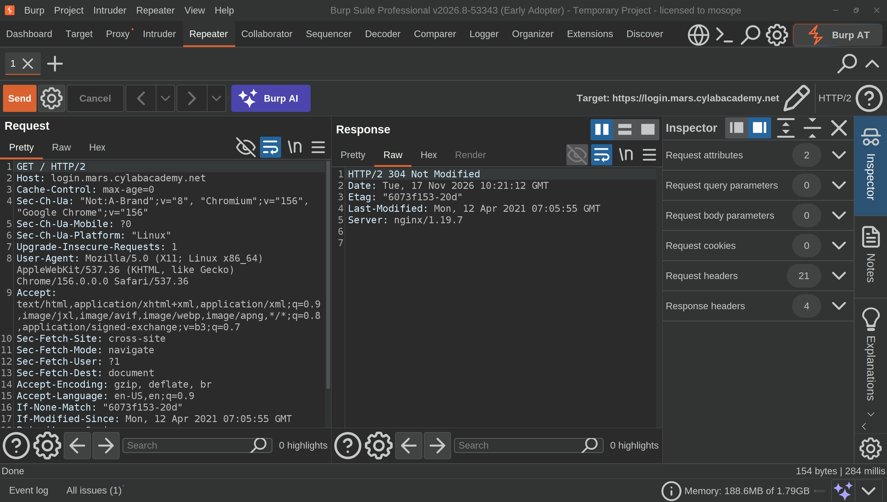
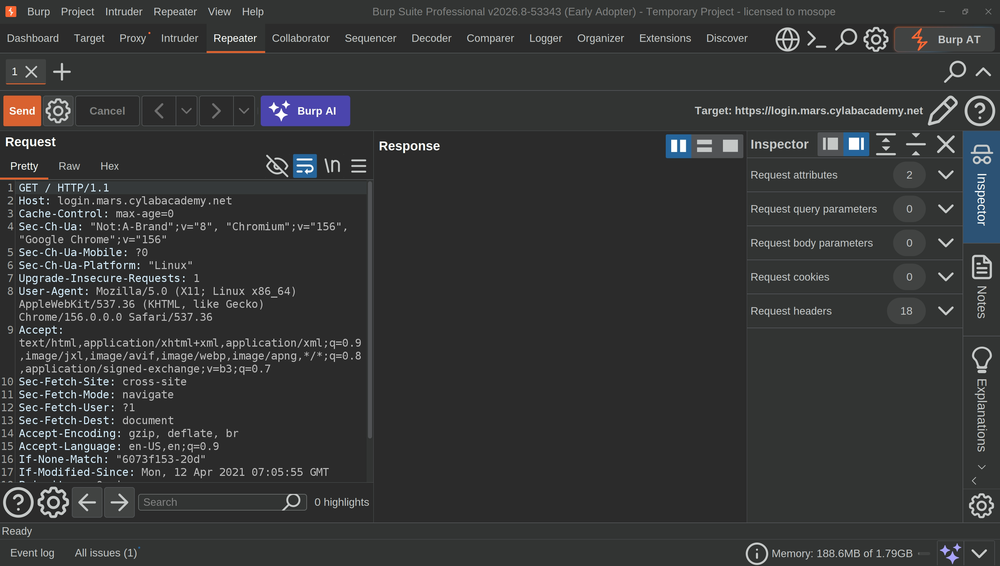
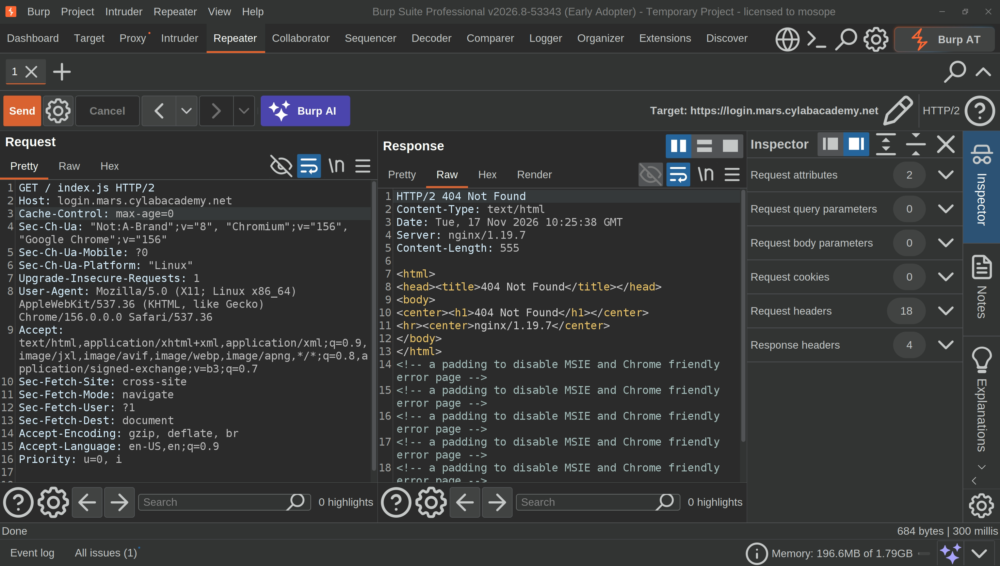

# login (Mars)

| | |
|---|---|
| **Category** | Web Exploitation / Authentication |
| **Difficulty** | Medium |
| **Platform** | CyLab Security Academy — *picoMini by redpwn* |
| **Status** | ✅ Solved (flag decoded from client-side source) |
| **Tools** | Burp Suite Professional (Proxy, Repeater, Decoder) |

## Challenge Description

> My dog-sitter's brother made this website but I can't get in; can you help?
>
> `login.mars.cylabacademy.net`

No credentials, no hints beyond the framing — a strong signal that the login logic is naive and worth inspecting directly rather than attacking with brute force or SQL injection.



## Approach

### 1. Pull the raw login page through Burp

The first fetch returned a cached `304 Not Modified` because the browser sent conditional headers (`If-None-Match`, `If-Modified-Since`) left over from an earlier visit:





Removing the `If-None-Match` and `If-Modified-Since` headers forced a fresh `200 OK` with the real page body:

```html
<!doctype html>
<html>
    <head>
        <link rel="stylesheet" href="styles.css">
        <script src="index.js"></script>
    </head>
    <body>
        <div>
          <h1>Login</h1>
          <form method="POST">
            <label for="username">Username</label>
            <input name="username" type="text"/>
            <label for="username">Password</label>
            <input name="password" type="password"/>
            <input type="submit" value="Submit"/>
          </form>
        </div>
    </body>
</html>
```

No HTML comments or inline script — but a linked `index.js` file was the obvious next target.

### 2. Fetch index.js

A first attempt accidentally introduced a stray space in the request path (`GET / index.js` instead of `GET /index.js`), which the server parsed as a malformed request and returned `404 Not Found`:



Correcting the path returned the actual script:

```javascript
(async () => {
  await new Promise((e) => window.addEventListener("load", e));
  document.querySelector("form").addEventListener("submit", (e) => {
    e.preventDefault();
    const r = { u: "input[name=username]", p: "input[name=password]" };
    const t = {};
    for (const e in r) t[e] = btoa(document.querySelector(r[e]).value).replace(/=/g, "");
    return "YWRtaW4" !== t.u
      ? alert("Incorrect Username")
      : "cGljb0NURns1M3J2M3JfNTNydjNyXzUzcnYzcl81M3J2M3JfNTNydjNyfQ" !== t.p
      ? alert("Incorrect Password")
      : void alert(`Correct Password! Your flag is ${atob(t.p)}.`);
  });
})();
```

### 3. The vulnerability

**All authentication happens entirely client-side.** The script base64-encodes whatever the user types and compares it against two hardcoded base64 strings — meaning the "correct" username and password (and therefore the flag, since the password literally *is* the flag) are sitting in plaintext-equivalent form in a publicly-served JavaScript file.

### 4. Decode the hardcoded values

Using Burp's Decoder (Base64):

| Encoded | Decoded |
|---|---|
| `YWRtaW4` | `admin` |
| `cGljb0NURns1M3J2M3JfNTNydjNyXzUzcnYzcl81M3J2M3JfNTNydjNyfQ` | `picoCTF{53rv3r_53rv3r_53rv3r_53rv3r_53rv3r}` |

### 5. Log in

Submitting `admin` / `picoCTF{53rv3r_53rv3r_53rv3r_53rv3r_53rv3r}` on the login form triggers the page's own success branch, which reveals the flag directly via `alert()`.

## Flag

```
picoCTF{53rv3r_53rv3r_53rv3r_53rv3r_53rv3r}
```

## Key Takeaways

- Any authentication check performed entirely in client-side JavaScript is trivially bypassable — the "secret" values are shipped to every visitor's browser.
- `btoa`/`atob` (base64) is encoding, not encryption or hashing — comparing against a hardcoded base64 string offers no real protection, and in this case the password itself was recoverable by simply decoding the comparison constant.
- Stale browser cache headers (`If-None-Match`, `If-Modified-Since`) can mask the real content of a page when replaying requests through Burp — always check for and strip conditional headers if a response unexpectedly comes back as `304`.
