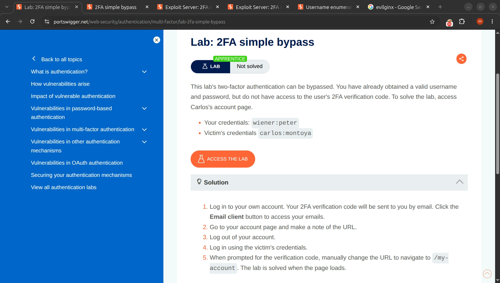
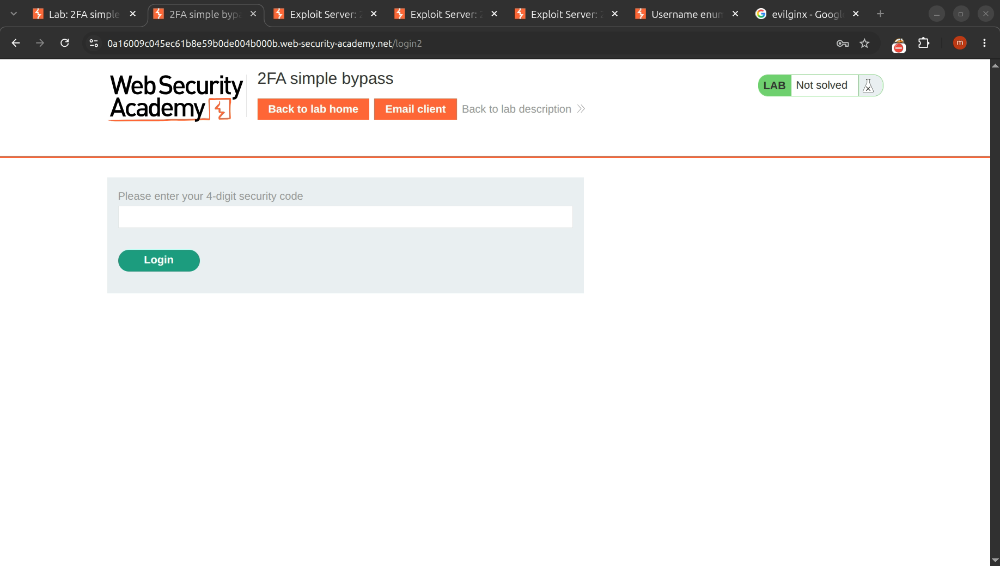

# PortSwigger Lab: 2FA Simple Bypass

| | |
|---|---|
| **Category** | Authentication / Multi-Factor Authentication |
| **Difficulty** | Apprentice |
| **Platform** | PortSwigger Web Security Academy |
| **Status** | ✅ Solved |
| **Tools** | Browser only (no Burp manipulation required for this lab) |

## Lab Description

> This lab's two-factor authentication can be bypassed. You have already obtained a valid username and password, but do not have access to the user's 2FA verification code. To solve the lab, access Carlos's account page.
>
> - Your credentials: `wiener:peter`
> - Victim's credentials: `carlos:montoya`



## Approach

### 1. Baseline login (own account)

Logged in as `wiener:peter`. The app sends a 2FA verification code by email and prompts for it at `/login2`:



Retrieved the code via the lab's built-in email client, submitted it, and successfully reached `/my-account` — noting the exact URL for reuse.

### 2. Victim login attempt

Logged out, then logged back in using the victim's credentials (`carlos:montoya`). This produces the same password-accepted → `/login2` flow, but this time **no code is available** (it was sent to Carlos's email, which is inaccessible).

### 3. The bypass

Rather than submitting any code, the browser's address bar was used to navigate **directly** to:

```
https://<lab-id>.web-security-academy.net/my-account
```

Navigating directly to `/my-account` loaded Carlos's account page without ever submitting a verification code, and the lab flipped to **"Solved"**.

### Root Cause

The server treats "password accepted" as sufficient to create an authenticated session capable of reaching `/my-account`. The 2FA code screen is enforced only by the **front-end flow** — the application simply doesn't present a link to `/my-account` until a code is submitted — rather than by the backend re-validating that the second factor was actually completed for that session. Manually typing the URL skips the client-side gate entirely, and the server never notices anything is missing.

## Key Takeaways

- Two-factor authentication is only meaningful if the **server-side session state** tracks whether the second factor was completed — gating access purely through which links/pages the client chooses to show is not real enforcement.
- This class of bug is detected almost entirely through manual navigation (typing URLs directly) rather than through request tampering in Burp — a good reminder that not every authentication flaw requires proxy manipulation.
- Always note the authenticated URL structure (e.g. `/my-account`) while logged into your *own* account — it's frequently reusable against other accounts once any step of the auth chain can be skipped.
